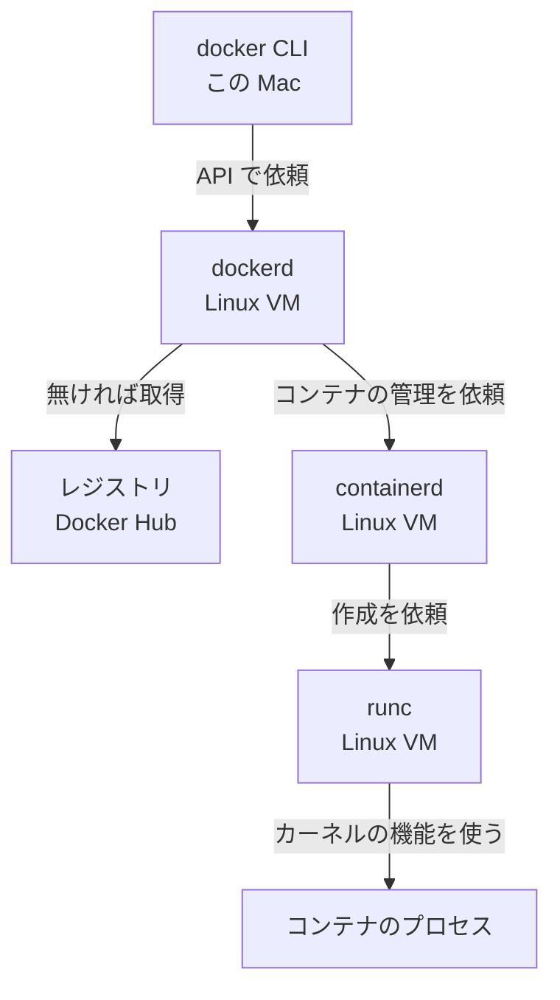

# P0: なぜコンテナか / Docker の構造

このフェーズの問いは1つです。**「コンテナとは何で、`docker` と打つと何が起きるのか」**

全3ステップです。設定ファイルはまだ書きません。

> 検証環境: Docker Desktop / Docker Engine 29.8.0 / macOS 26.6.2（Apple シリコン）
> 出力の版番号は環境で変わります。見比べるのは「形」と「同じか違うか」です。

---

## P0-1: 「動かない」はどこで起きるのか

**❓ この回の問い**: 同じコードなのに、自分のパソコンでは動いて、別のパソコンでは動かないことがある。
→ **動くかどうかは、いったい何で決まるのか？**

**作るもの / 確かめること**: アプリの下にある層を、自分のパソコンで確かめる
**重要度**: ⚪ 背景知識 — 直接打つコマンドではないが、Docker が解く問題そのものだから
**前ステップとの接続**: 最初のステップ

### 1-0. このステップの初出トークン

**Docker**: `コンテナ` `イメージ`（名前だけ）
**Linux**: なし
**その他**: 共有ライブラリ

### 1-1. 🔮 予測してから実行する

新しい Django の API を動かすとします。コードの他に、何が要るでしょうか。**3つ書き出してから**読み進めてください。

書けたら、この Mac に入っているものを確かめます。

**実行場所**: どこでもよい（ターミナル）

```bash
# どの Python が使われるか
which -a python3

# その Python の版
python3 --version

# OS の種類と CPU の種類
uname -sm

# ls コマンドが使う部品
otool -L /bin/ls
```

この環境の出力は次のとおりです。

```text
~/.local/bin/python3
/usr/bin/python3
Python 3.14.3
Darwin arm64
/bin/ls:
	/usr/lib/libutil.dylib (compatibility version 1.0.0, current version 1.0.0)
	/usr/lib/libncurses.5.4.dylib (compatibility version 5.4.0, current version 5.4.0)
	/usr/lib/libSystem.B.dylib (compatibility version 1.0.0, current version 1356.0.0)
```

✅ 検証済み: macOS 26.6.2 / arm64。`which -a` の出力は、ホームディレクトリを `~` に置き換えて載せた。

分かったことは3つです。

- **Python は1台に2つ入っている**。どちらが使われるかは、そのパソコンの設定で決まる
- **OS と CPU に種類がある**。この Mac は `Darwin` と `arm64`
- **小さな `ls` でさえ、別の部品に頼っている**。`.dylib` の部品が無ければ動かない

> 🧒 **かみくだくと**: 共有ライブラリ（shared library）= たくさんのプログラムが一緒に使う部品。みんなの道具箱です。macOS の `.dylib` が、これにあたります。

### 1-2. 🔬 仕組み解剖

アプリが動く条件を層にすると、こうなります。

```text
┌──────────────────────────────┐
│ アプリのコード               │ 自分で書いたもの
├──────────────────────────────┤
│ 言語の実行環境と依存         │ Python / Django
├──────────────────────────────┤
│ 共有ライブラリとコマンド     │ .dylib / ls など
├──────────────────────────────┤
│ OS の土台                    │ 名前は次回明かす
├──────────────────────────────┤
│ CPU                          │ arm64 など
└──────────────────────────────┘
```

**見てほしいところ**: 自分で書いたのは一番上だけです。「動かない」の原因は、下の4層にもあります。

なぜを下っていきます。

```text
なぜ、他のパソコンでは動かないのか
  → コードの下の層が、パソコンごとに違うから
      → なぜ、層が違うのか
          → 人によって、入れたものも入れた時期も違うから
              → なぜ、手順書で揃えられないのか
                  → 手順書は「やること」を書くだけで、結果の同じさは保証しないから
```

ここから、解き方が見えてきます。

| やり方 | 中身 | 弱点 |
| --- | --- | --- |
| 手順書 | 同じものを入れる手順を配る | 人とパソコンごとに結果がずれる |
| **コンテナ** | コードと、その下で要るものをまとめて運ぶ | 土台は運べない（次回） |

**既知スタックとの対応**: `package-lock.json` は npm の依存だけを固定します。Node.js 本体や OS の部品までは固定しません。コンテナは、その下の層まで一緒に運びます。

**ビルド時かランタイム時か / ホストからの見え方 / 失敗時の挙動**: このステップではコンテナを動かさないので対象外です。P1 から扱います。

### 1-3. 🐧 Linux注

このステップは macOS だけで進めるので、Linux注はありません。

### 1-4. 解説 — なぜこうするか

`イメージ`（image）は、アプリと、動かすために要るものをまとめた**荷造り済みの箱**です。
`コンテナ`（container）は、その箱を開けて動かし始めた**1つのプロセス**です。プロセスとは、動いているプログラムのことです。

> 🧒 **かみくだくと**: 引っ越しにたとえます。荷物がアプリです。封をした段ボールがイメージです。箱を開けて生活を始めた部屋がコンテナです。正確な定義は P1 で確かめます。

🧠 **Docker の考え方**: 環境を手順で再現せず、環境そのものを箱に詰めて運ぶ。

### 1-5. 🏢 実務メモ

> 🏢 **実務メモ**: Docker は、コードと依存をまとめて運ぶことで、環境の違いによる問題を減らすために使われます。
> 根拠: https://www.docker.com/resources/what-container/

### 1-6. 🔮 動作確認

次の2つを、自分の言葉で答えてください。

1. `python3 --version` の結果が同僚と違うとき、問題になりうるのはどの層か
2. `/bin/ls` は `.dylib` が消えたら動くか

<details><summary>答え</summary>

1. 「言語の実行環境」の層。版の違いで、使える機能が変わる
2. 動かない。`otool -L` の出力は、`ls` がその部品に頼っていることを示している

</details>

### 1-7. ✅ 想起チェック

何も見ずに答えてください。

1. アプリが動く条件を、上から5層言えますか
2. 手順書で環境が揃わない理由は何ですか
3. イメージとコンテナの違いを、引っ越しのたとえで言えますか

<details><summary>答え</summary>

1. コード / 実行環境と依存 / 共有ライブラリとコマンド / OS の土台 / CPU
2. 手順書は「やること」を書くだけで、結果の同じさを保証しないから
3. イメージは封をした段ボール。コンテナは箱を開けて生活を始めた部屋

</details>

### 1-8. 初出トークンの回収確認

| トークン | 扱い |
| --- | --- |
| `コンテナ` | 1-4 で解説。⏭️ P1-1 で実物を動かす |
| `イメージ` | 1-4 で解説。⏭️ P1-2 で実物を確かめる |
| 共有ライブラリ | 1-1 で解説 |

### 📇 まとめカード

> **動くかどうかは、コードの下の層で決まる。**

**残った問い**: コンテナは下の層を運ぶ。でも1-2の表には「土台は運べない」とあった。土台とは何で、なぜ運べないのか。

---
▶ **次**: P0-2 ベアメタル・VM・コンテナ

---

## P0-2: ベアメタル・VM・コンテナ

**❓ この回の問い**: 前回の答えは「動くかどうかは下の層で決まる」だった。ただし、土台は運べないと書いた。
→ **土台とは何で、下の層をどこまで運べばよいのか？**

**作るもの / 確かめること**: Mac と Docker の2つのカーネルを並べて見る
**重要度**: ⚪ 背景知識 — 「Linux 用のイメージがなぜ Mac で動くのか」が分からないと、後のエラーが読めないから
**前ステップとの接続**: P0-1 の「OS の土台」に名前を付ける

### 2-0. このステップの初出トークン

**Docker**: `カーネル` `VM` `ホスト`
**Linux**: なし
**その他**: ベアメタル

### 2-1. 実践

**土台の名前は `カーネル`（kernel）です。**

> 🧒 **かみくだくと**: カーネル = パソコンの管理人。アプリが「ファイルを開きたい」「メモリがほしい」と頼むと、代わりに機械を動かします。家でいえば、土台と水道と電気です。

まず、OS の版とカーネルの版を比べます。

**🔮 予測**: 次の2つの数字は同じでしょうか。

**実行場所**: どこでもよい（ターミナル）

```bash
# macOS の版
sw_vers -productVersion

# カーネルの版
uname -r
```

```text
26.6.2
25.6.0
```

✅ 検証済み: macOS 26.6.2 / arm64

**数字が違います。** カーネルは OS の一部で、OS 全体とは別に版番号を持っています。

次に、Docker が使っているカーネルを見ます。Docker Desktop を起動してから実行してください。

**🔮 予測**: Mac と同じカーネルでしょうか。

```bash
# この Mac のカーネル
uname -sr

# Docker のデーモンが動いている場所のカーネル
docker info --format '{{.OSType}} {{.KernelVersion}}'
```

```text
Darwin 25.6.0
linux 7.0.12-linuxkit
```

✅ 検証済み: Docker Desktop / Docker Engine 29.8.0 / macOS 26.6.2

**1台のパソコンに、カーネルが2つ見えました。** これがこの回の山場です。

`docker info` の `--format` は、表示する項目を選ぶオプションです。`{{.KernelVersion}}` のように項目名を書きます。

### 2-2. 🔬 仕組み解剖

ソフトを動かす方法は、大きく3つあります。

```text
ベアメタル             VM                     コンテナ

┌────────────┐    ┌────────────┐      ┌────┐ ┌────┐
│ アプリ     │    │ アプリ     │      │箱A │ │箱B │
├────────────┤    ├────────────┤      └────┘ └────┘
│ OS         │    │ ゲストOS   │      ┌────────────┐
│ (カーネル) │    │ (カーネル) │      │ カーネル   │← 共有
├────────────┤    ├────────────┤      ├────────────┤
│ 機械       │    │ 仮想の機械 │      │ 機械       │
└────────────┘    ├────────────┤      └────────────┘
                  │ 本物の機械 │
                  └────────────┘
```

**見てほしいところ**: VM はカーネルを自分で持っています。コンテナは持っていません。下のカーネルを借ります。

| 方法 | 正式名称 | カーネル | 分離の仕組み | 向いている場面 |
| --- | --- | --- | --- | --- |
| ベアメタル | bare metal | 機械に1つ | 分離なし | 性能を最大にしたい |
| VM | virtual machine（仮想マシン） | VM ごとに1つ | 機械ごと分ける | 別の OS を動かしたい |
| コンテナ | container | ホストのものを共有 | プロセスを分ける | アプリを速く運びたい |

> 🧒 **かみくだくと**: VM = パソコンの中に作った、ソフトだけのパソコン。ベアメタル = 仮想化をしない、本物の機械です。

なぜを下っていきます。

```text
なぜ、コンテナは土台を運ばないのか
  → カーネルを借りて動くから
      → なぜ、借りられるのか
          → アプリとカーネルのやりとりの決まりが、Linux 同士で共通だから
              → では、Mac でなぜ Linux のコンテナが動くのか
                  → Mac のカーネルは Linux ではないので、Linux の VM を1つ用意して借りるから
```

Docker Desktop の中はこうなっています。

```text
┌─────────────────────────────────────┐
│ この Mac（Darwin カーネル）         │
│  ┌───────────────────────────────┐  │
│  │ Linux VM（Linux カーネル）    │  │
│  │  ← 本教材で「ホスト」と呼ぶ   │  │
│  │   ┌────────┐ ┌────────┐       │  │
│  │   │コンテナ│ │コンテナ│       │  │
│  │   └────────┘ └────────┘       │  │
│  └───────────────────────────────┘  │
└─────────────────────────────────────┘
```

**見てほしいところ**: コンテナのすぐ外側は Mac ではなく Linux VM です。

**本教材の約束**: `ホスト` と書いたら、**コンテナのすぐ外側 = Linux VM** を指します。Mac 本体は `この Mac` と書きます。

> 🧒 **かみくだくと**: ホスト（host）= コンテナが住む建物。ゲスト（guest）= その中に入る側です。

**既知スタックとの対応**: 対応物なし。React や Django はカーネルの上で動くアプリなので、カーネルを借りるという関係は出てきません。

**なぜこの設計なのか**: カーネルを共有すると、OS を丸ごと起動しなくて済みます。その代わり、分離は VM より弱くなります。この弱さは P6 のセキュリティで扱います。

**失敗時の挙動**: Docker Desktop が止まっていると、`docker info` のサーバ情報は取れません。`Cannot connect to the Docker daemon` と出たら、まず Docker Desktop の起動を確かめます。

✅ 検証済み: Docker Desktop 停止時に、`docker version` が上記のエラーを返すことを確認した。

### 2-3. 🐧 Linux注

> 🐧 **Linux注**: `linuxkit` は、コンテナを動かすために作られた小さな Linux の仕組みです。Docker Desktop の VM に使われているので、カーネルの版番号に名前が付いています。

### 2-4. 解説 — なぜこうするか

コンテナは「下の層のどこまでを運ぶか」の答えです。**カーネルより上だけ**を運びます。

だから、コンテナの中の Linux の種類は、箱ごとに変えられます。Debian の箱も Alpine の箱も、同じカーネルの上で動きます。P0-3 で実際に確かめます。

🧠 **Docker の考え方**: コンテナはホストのカーネルの上で動く、隔離されたプロセス。OS を丸ごと起動しているわけではない。

### 2-5. 🏢 実務メモ

> 🏢 **実務メモ**: コンテナはホストの OS カーネルを共有し、VM はそれぞれが OS を持ちます。この違いが、起動の速さと分離の強さの差になります。
> 根拠: https://www.docker.com/resources/what-container/

### 2-6. 🔮 動作確認

1. `uname -r` と `sw_vers -productVersion` の結果が違うのはなぜか
2. Docker Desktop が動いていないとき、`docker info` のカーネル欄はどうなるか
3. Linux 用のイメージを、Linux サーバで動かすときに VM は要るか

<details><summary>答え</summary>

1. カーネルは OS の一部で、別の版番号を持っているから
2. デーモンにつながらないのでエラーが出る。カーネルの情報は得られない
3. 要らない。Linux のカーネルをそのまま借りられる

</details>

### 2-7. ✅ 想起チェック

1. カーネルとは何ですか
2. VM とコンテナの一番の違いは何ですか
3. 本教材の `ホスト` は何を指しますか

<details><summary>答え</summary>

1. アプリの頼みを受けて機械を動かす、OS の中心部分
2. VM は自分のカーネルを持つ。コンテナはホストのカーネルを共有する
3. コンテナのすぐ外側にある Linux VM

</details>

### 2-8. 初出トークンの回収確認

| トークン | 扱い |
| --- | --- |
| `カーネル` | 2-1 と 2-2 で解説 |
| `VM` | 2-2 で解剖 |
| `ホスト` | 2-2 で解剖 |
| ベアメタル | 2-2 で解説 |

### 📇 まとめカード

> **コンテナはカーネルを運ばず、ホストから借りる。**

**残った問い**: コンテナの置き場所は分かった。では `docker` と打ったとき、誰がコンテナを作っているのか。

---
▶ **次**: P0-3 `docker` と打つと何が起きるか

---

## P0-3: `docker` と打つと何が起きるか

**❓ この回の問い**: 前回の答えは「コンテナは Linux VM の中で動く」だった。でも、`docker` と打つのは Mac のターミナルだ。
→ **Mac で打った命令は、どうやって Linux VM の中でコンテナになるのか？**

**作るもの / 確かめること**: イベントを流しながら hello-world を動かす
**重要度**: ⚪ 背景知識 — エラーを出したプログラムがどれかを見分けるために要るから
**前ステップとの接続**: P0-2 の Linux VM の中で動くプログラムを見る

### 3-0. このステップの初出トークン

**Docker**: `docker run` `docker system events` `OCI`
**Linux**: `root`（コンテナの中の出力に出る）
**その他**: デーモン

### 3-1. 実践

ターミナルを2つ開きます。

**ターミナル A**: Docker の中の出来事を流し続けます。

```bash
docker system events --format '{{.Type}} {{.Action}}'
```

何も表示されず、止まったように見えます。それで正常です。

**🔮 予測**: ターミナル B で `docker run --rm hello-world` を打ちます。A にはどんな順番で何が出るでしょうか。「イメージ」「コンテナ」「ネットワーク」の言葉を使って予想してください。

**ターミナル B**: hello-world を動かします。

```bash
# 手元の hello-world を消す。無ければエラーになるが問題ない
docker image rm hello-world

docker run --rm hello-world
```

B の出力です。後半は省略しました。

```text
Unable to find image 'hello-world:latest' locally
latest: Pulling from library/hello-world
...
Status: Downloaded newer image for hello-world:latest

Hello from Docker!
This message shows that your installation appears to be working correctly.
```

A の出力です。Docker の出来事が、時間の順に並びます。

```text
image pull
container create
container attach
network connect
container start
network disconnect
container die
container destroy
```

✅ 検証済み: Docker Engine 29.8.0。A の出力から、別のコンテナのヘルスチェックによる行を除いた。動かしているコンテナがあれば、`exec_create` などの行も混ざる。2回目に `image pull` が出ないことも確認した。

A は `Ctrl + C` で止めます。

**イメージが手元にあれば `image pull` は出ません。** B でもう一度 `docker run --rm hello-world` を実行して確かめてください。

### 3-2. 🔬 仕組み解剖

#### `docker run --rm hello-world` を分解する

| 部品 | 正式名称 | 実行時に何が起きるか |
| --- | --- | --- |
| `docker` | Docker CLI | 命令をデーモンへ送るだけのプログラム |
| `run` | コンテナの作成と起動 | イメージからコンテナを作り、起動する |
| `--rm` | 自動削除オプション | コンテナが止まったら自動で消す。A の `container destroy` がこれ |
| `hello-world` | イメージ名 | 手元に無ければレジストリから取得する |

> 🧒 **かみくだくと**: デーモン（daemon）= 裏で動き続けて、頼まれるのを待つプログラム。Docker のデーモンは `dockerd` です。
> レジストリ（registry）= イメージの置き場。段ボールの配送センターです。Docker Hub が代表例です。

#### 命令の旅



**見てほしいところ**: Mac の中で動いているのは CLI だけです。残りはすべて Linux VM の中で動きます。

入っている部品は、`docker version` で確かめられます。

```bash
docker version --format '{{range .Server.Components}}{{.Name}} {{.Version}}{{"\n"}}{{end}}'
```

```text
Engine 29.8.0
containerd v2.3.5
runc 1.5.1
docker-init 0.19.0

```

✅ 検証済み: Docker Engine 29.8.0

| 部品 | 役割 | 実際の担当 |
| --- | --- | --- |
| Docker CLI | 命令を受け付ける | `docker` コマンド |
| dockerd | API を受け、イメージなどを管理する | Docker Engine のデーモン |
| containerd | コンテナの一生を管理する | コンテナランタイム |
| runc | コンテナを1つ作って起動する | 低レベルのランタイム |

`OCI`（Open Container Initiative）は、イメージと実行方法の業界標準を決める団体です。runc は、この標準に沿った実装の1つです。標準があるので、Docker で作ったイメージを別のツールでも動かせます。

> 🧒 **かみくだくと**: OCI = 段ボールの規格を決める団体。規格が同じなら、別の会社のトラックでも運べます。

なぜを下っていきます。

```text
なぜ、CLI とデーモンを分けるのか
  → CLI は命令を出したらすぐ終わるが、コンテナは動き続けるから
      → なぜ、それで分ける必要があるのか
          → コンテナを見守るプログラムが、裏で動き続ける必要があるから
              → なぜ、Mac の CLI から Linux VM に命令できるのか
                  → CLI とデーモンは API でやりとりするから
```

**既知スタックとの対応**: React から FastAPI を呼ぶ関係に似ています。CLI がクライアントで、デーモンが API サーバです。ただし、Docker の CLI は通常 HTTP サーバの URL ではなく、ソケットというファイルを通して話します。

**ビルド時かランタイム時か**: `docker run` はランタイムの命令です。

**ホストからの見え方**: A の `network connect` が示すとおり、起動の前に、ホスト側でネットワークの準備が行われます。

**失敗時の挙動**: エラーの出どころで、調べる層が変わります。

| メッセージの例 | 出どころ | 調べること |
| --- | --- | --- |
| `Cannot connect to the Docker daemon` | CLI → dockerd の間 | Docker Desktop が動いているか |
| `pull access denied` / `repository does not exist` | dockerd → レジストリの間 | イメージ名のつづり、ネットワーク、ログイン状態 |

✅ 検証済み: 存在しない名前のイメージで `docker run` を実行し、上記のメッセージが出ることを確認した。

### 3-3. 🐧 Linux注

> 🐧 **Linux注**: `root` は Linux の管理者ユーザです。P1-4 の `ps` の結果に出てきます。権限の詳細は P3-2 と P6-2 で扱います。

### 3-4. 解説 — なぜこうするか

コンテナが同じカーネルを借りることも確かめます。

**🔮 予測**: Debian の箱と Alpine の箱で、カーネルの版はどうなるでしょうか。Linux の種類は違うのに、結果は同じでしょうか。

```bash
docker run --rm alpine sh -c 'grep PRETTY /etc/os-release; uname -r'
docker run --rm python:3.13-slim sh -c 'grep PRETTY /etc/os-release; uname -r'
docker info --format '{{.KernelVersion}}'
```

```text
PRETTY_NAME="Alpine Linux v3.24"
7.0.12-linuxkit
PRETTY_NAME="Debian GNU/Linux 13 (trixie)"
7.0.12-linuxkit
7.0.12-linuxkit
```

✅ 検証済み: Docker Engine 29.8.0

**箱の中の Linux は違うのに、カーネルは同じです。** P0-2 の説明どおりです。

> 🧒 **かみくだくと**: Alpine と Debian は Linux の種類です。OS のうち、カーネルより上の部分が違います。Alpine はとても小さいことで知られています。

`sh -c '...'` は、文字列をシェルに渡して実行します。`grep PRETTY` は `PRETTY` を含む行を取り出します。`/etc/os-release` は Linux の種類が書かれたファイルです。

🧠 **Docker の考え方**: `docker` は窓口で、実際に働くのはデーモンとランタイム。

### 3-5. 🏢 実務メモ

> 🏢 **実務メモ**: Docker はクライアントとデーモンの構成で動き、両者は API で通信します。そのため、クライアントは別のマシンのデーモンにもつなげられます。この仕組みは P7-4 のデプロイで使います。
> 根拠: https://docs.docker.com/get-started/docker-overview/

### 3-6. 🔮 動作確認

1. `docker run --rm hello-world` を2回続けて打つと、2回目のイベントはどう変わるか
2. `--rm` を外すと `container destroy` はどうなるか
3. Docker Desktop を止めて `docker run` すると、どの部分で失敗するか

<details><summary>答え</summary>

1. `image pull` が出なくなる
2. 出なくなる。止まったコンテナが残る。P1-2 で確かめる
3. CLI からデーモンへの接続で失敗する

</details>

### 3-7. ✅ 想起チェック

1. `docker run` が届くまでの順番を、CLI からコンテナのプロセスまで言えますか
2. Mac の中で動いているのは、どの部品ですか
3. `OCI` は何のためにありますか

<details><summary>答え</summary>

1. CLI → dockerd → containerd → runc → コンテナのプロセス
2. Docker CLI。ほかの部品は Linux VM の中で動く
3. イメージと実行方法の標準を決め、別のツールでも動かせるようにするため

</details>

### 3-8. 初出トークンの回収確認

| トークン | 扱い |
| --- | --- |
| `docker run` | 3-2 で解剖。⏭️ `-d` と `-p` は P1-1 で回収 |
| `docker system events` | 3-1 で実践 |
| `OCI` | 3-2 で解説 |
| `root` | 3-3 で解説。⏭️ P3-2 と P6-2 で回収 |
| デーモン | 3-2 で解説 |

⏭️ **後で回収**: `docker image rm` は P1-2 で扱います。今は「手元のイメージを消す」とだけ理解して進みます。

### 📇 まとめカード

> **`docker` は窓口。CLI → dockerd → containerd → runc の順に頼んでいる。**

---

## P0 のなぜなぜの鎖

```text
なぜ、別のパソコンでは動かないのか
  → コードの下の層が違うから
      ↓ では、下の層を運べばよい
どこまで運ぶのか
  → カーネルより上だけ。カーネルはホストから借りる
      ↓ では、Mac でなぜ Linux のコンテナが動くのか
  → Docker Desktop が Linux VM を1つ用意しているから
      ↓ では、誰がコンテナを作るのか
  → CLI の依頼を受けて dockerd、containerd、runc が作る
      ↓ では、そのコンテナはどう動かすのか
```

---

## ▶ 次は P1

P0 はここまでです。M2 はありません。まだ再現する設定ファイルが無いためです。

`docs/01-glossary.md` の「自分の言葉」の列を埋めてから、P1 に進みます。

**前提チェック**

- [ ] アプリが動く条件を5層で言える（P0-1）
- [ ] コンテナがカーネルを借りると説明できる（P0-2）
- [ ] この教材の `ホスト` が何かを言える（P0-2）
- [ ] `docker run` の裏側の順番を言える（P0-3）
