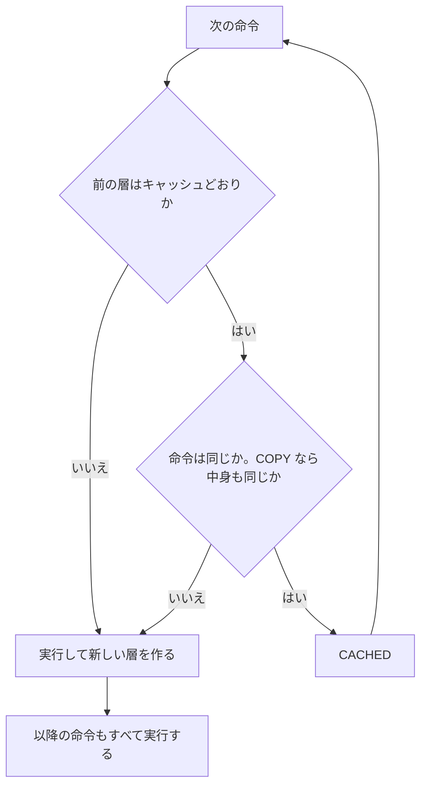

# P2: Dockerfile で API をイメージ化する

このフェーズの問いは1つです。**「自分のアプリの箱は、どう作るのか」**

全5ステップ、プロジェクト PJ1、フェーズ末パックです。EC の API を `/api/health` だけ作り、イメージにします。

> 検証環境: Docker Desktop / Docker Engine 29.8.0 / macOS 26.6.2（Apple シリコン）
> 使うイメージ: `python:3.13-slim` / `alpine:latest`
> 作業場所: リポジトリの `apps/api/`。このフェーズのコマンドは、特に断りがなければすべてここで実行します。
> ポート `8000` を使います。使用中なら `8001:8000` のように左の数字を変えてください。

---

## P2-1: 最小の Dockerfile

**❓ この回の問い**: P1 の答えは「コンテナはイメージから起動したプロセス」だった。ここまで、イメージは人が作ったものを借りていた。
→ **自分のイメージは、どう作るのか？**

**作るもの / 確かめること**: Python で1行を出すだけのイメージを作る
**重要度**: 🔴 毎日使う — Dockerfile は、Docker を使う仕事で最も多く読み書きするファイルだから
**前ステップとの接続**: P1 の `docker run` に渡すイメージを、自分で作る

### 1-0. このステップの初出トークン

**Docker**: `FROM` `CMD` `docker build`
**補助**: `-t`
**Linux**: なし
**その他**: Dockerfile

### 1-1. 実践

リポジトリのルートで、作業場所を作ります。

```bash
mkdir -p apps/api
cd apps/api
```

**ファイル**: `apps/api/Dockerfile`（新規・全文）

```dockerfile
FROM python:3.13-slim
CMD ["python", "-c", "print('hello from image')"]
```

**実行場所**: `apps/api/`

```bash
docker build -t ec-api:step1 .
docker run --rm ec-api:step1
```

```text
hello from image
```

`docker build` の最後の `.` は忘れやすいので、注意してください。

一覧と中身を確かめます。

```bash
docker image ls ec-api
docker history ec-api:step1 --format '{{.Size}}  {{.CreatedBy}}' | head -2
```

```text
IMAGE          ID             DISK USAGE   CONTENT SIZE   EXTRA
ec-api:step1   edc64c189c95        202MB         43.3MB

0B  CMD ["python" "-c" "print('hello from image'…
0B  CMD ["python3"]
```

✅ 検証済み: Docker Engine 29.8.0。ID とサイズは取得した時期で変わる。

### 1-2. 🔬 仕組み解剖

> 🧒 **かみくだくと**: Dockerfile = 段ボールの荷造り手順書。上から順に実行されます。`docker build` は、その手順書どおりに箱を作る作業です。

| 部品 | 正式名称 | 実行時に何が起きるか |
| --- | --- | --- |
| `FROM python:3.13-slim` | FROM 命令 | **ビルド時**に、土台のイメージを決める。手元に無ければ pull する |
| `CMD [...]` | CMD 命令 | **ランタイム**の既定のコマンドを、イメージに記録する。ビルド時には実行されない |
| `docker build` | イメージのビルド | Dockerfile を上から実行し、イメージを作る |
| `-t ec-api:step1` | タグ付け（tag） | できたイメージに `名前:タグ` を付ける |
| `.` | ビルドコンテキスト | 材料のファイルを置いた場所。⏭️ P2-4 で回収 |

ここで一番大事なのは、**いつ実行されるか**です。

```text
Dockerfile ──docker build──▶ イメージ ──docker run──▶ コンテナ
             （ビルド時）                （ランタイム）
             FROM を処理                 CMD を実行
             CMD は記録だけ
```

**見てほしいところ**: `CMD` はビルド時に動きません。だから `docker build` の出力に `hello from image` は出ません。

`CMD` は既定値なので、`docker run` の最後に書くと置き換わります。

```bash
docker run --rm ec-api:step1 python --version
```

```text
Python 3.13.18
```

✅ 検証済み: Docker Engine 29.8.0

なぜを下っていきます。

```text
なぜ、FROM が必要なのか
  → 箱の中に、Python を動かす「OS の上半分」が要るから
      → なぜ、カーネルは入れなくてよいのか
          → ホストのカーネルを借りるから（P0-2）
              → なぜ、CMD はビルド時に動かないのか
                  → イメージは材料で、プロセスを持たないから（P1-2）
```

| 確認すること | 内容 |
| --- | --- |
| **既知スタックとの対応** | `package.json` の `scripts.start` に近い。ただし CMD はイメージに焼き込まれ、OS の上半分ごと一緒に配られる |
| **なぜこの設計か** | 手順を文字にすると、同じイメージを誰でも作り直せる。手作業の環境構築は再現できない |
| **ビルド時かランタイム時か** | `FROM` はビルド時。`CMD` は記録がビルド時で、実行がランタイム |
| **ホストからの見え方** | `docker history` に命令の記録が残る |
| **失敗時の挙動** | 命令のつづりを間違えると、下のエラーでビルドが止まる |

`FORM` と打ち間違えた場合です。

```text
ERROR: failed to build: failed to solve: dockerfile parse error on line 1: unknown instruction: FORM (did you mean FROM?)
```

✅ 検証済み: Docker Engine 29.8.0

### 1-3. 🐧 Linux注

`python:3.13-slim` の中身は Debian です。

> 🐧 **Linux注**: Debian は Linux のディストリビューション（配布形態）の1つです。`slim` は、よく使う部品を削った小さい版を指します。

### 1-4. 解説 — なぜこうするか

`CMD` の `["...", "..."]` という書き方を **exec 形式** といいます。もう1つの書き方は P2-5 で比べます。

`docker history` の1行目の `0B` は、`CMD` がファイルを増やさないことを示します。2行目の `CMD ["python3"]` は土台のイメージが持っていた既定値です。**同じ命令は後の方が勝つ**ので、自分の `CMD` が使われます。

🧠 **Docker の考え方**: Dockerfile は箱そのものではなく、箱の作り方。

### 1-5. 🏢 実務メモ

> 🏢 **実務メモ**: 土台には信頼できる公式イメージを選びます。`FROM` は版まで指定すると、作る時期による差を減らせます。
> 根拠: https://docs.docker.com/build/building/best-practices/

### 1-6. 🔮 予測 → 動作確認

**問い**: `CMD` の文字を変えて、ビルドせずに `docker run` すると、出力は変わるでしょうか。

`Dockerfile` の `hello from image` を `hello again` に変えて、次を実行します。

```bash
docker run --rm ec-api:step1
docker build -t ec-api:step1 .
docker run --rm ec-api:step1
```

```text
hello from image
hello again
```

✅ 検証済み: Docker Engine 29.8.0

1回目は変わりません。`docker run` が読むのは Dockerfile ではなく、**できあがったイメージ**だからです。

確認できたら、文字を `hello from image` に戻します。

### 1-7. ✅ 想起チェック

1. `FROM` と `CMD` は、それぞれビルド時とランタイムのどちらで働きますか
2. `docker build -t a:b .` の最後の `.` は何ですか
3. Dockerfile を変えたのに、結果が変わりません。何を忘れていますか

<details><summary>答え</summary>

1. `FROM` はビルド時。`CMD` はビルド時に記録され、ランタイムで実行される
2. ビルドコンテキスト。材料を置いた場所
3. `docker build`

</details>

### 1-8. 初出トークンの回収確認

| トークン | 扱い |
| --- | --- |
| `FROM` | 1-2 で解剖 |
| `CMD` | 1-2 で解剖。⏭️ exec 形式は P2-5 で回収 |
| `docker build` | 1-2 で解剖 |
| `-t` | 1-2 で解剖 |
| Dockerfile | 1-2 で解説 |

### 📇 まとめカード

> **Dockerfile をビルドするとイメージになる。`CMD` は記録され、`docker run` で実行される。**

**残った問い**: このイメージには、まだ自分のコードが入っていない。どう入れるのか。

---
▶ **次**: P2-2 コードをイメージに入れる

---

## P2-2: コードをイメージに入れる

**❓ この回の問い**: 前回の答えは「`FROM` の上に手順を積むとイメージになる」だった。でも、箱の中に自分のコードが無い。
→ **この Mac のファイルは、どうやって箱に入れるのか？**

**作るもの / 確かめること**: Django のコードを置き、イメージの中の配置を確かめる
**重要度**: 🔴 毎日使う — `COPY` と `.dockerignore` の間違いは、動かない原因にも情報漏洩の原因にもなるから
**前ステップとの接続**: P2-1 の Dockerfile に `WORKDIR` と `COPY` を足す

### 2-0. このステップの初出トークン

**Docker**: `COPY` `WORKDIR` `.dockerignore`
**Linux**: 作業ディレクトリ
**その他**: なし

### 2-1. 実践

Django のコードを置きます。アプリの解説は最小限にします。Django を手元に入れる必要はありません。

| ファイル | 役割 |
| --- | --- |
| `src/manage.py` | Django の管理コマンドの入口 |
| `src/config/settings.py` | 設定。DB はまだ使わない |
| `src/config/urls.py` | URL の振り分け |
| `src/config/api.py` | Django Ninja の API。`/api/health` だけ |

**実行場所**: `apps/api/`

```bash
mkdir -p src/config
touch src/config/__init__.py
```

**ファイル**: `apps/api/src/manage.py`（新規・全文）

```python
import os
import sys

if __name__ == "__main__":
    os.environ.setdefault("DJANGO_SETTINGS_MODULE", "config.settings")
    from django.core.management import execute_from_command_line

    execute_from_command_line(sys.argv)
```

**ファイル**: `apps/api/src/config/settings.py`（新規・全文）

```python
SECRET_KEY = "dev-only-not-secret"
DEBUG = True
ALLOWED_HOSTS = ["*"]
INSTALLED_APPS = []
MIDDLEWARE = []
ROOT_URLCONF = "config.urls"
USE_TZ = True
```

**ファイル**: `apps/api/src/config/urls.py`（新規・全文）

```python
from django.urls import path

from config.api import api

urlpatterns = [
    path("api/", api.urls),
]
```

**ファイル**: `apps/api/src/config/api.py`（新規・全文）

```python
from ninja import NinjaAPI

api = NinjaAPI()


@api.get("/health")
def health(request):
    return {"status": "ok"}
```

> 🔓 **教材用の簡略化**: `SECRET_KEY` の直書き、`DEBUG = True`、`ALLOWED_HOSTS = ["*"]` は開発用です。
> **本番では**: P6-3 で秘密の値を外に出します。`DEBUG` は必ず無効にします。
> 根拠: https://docs.djangoproject.com/en/5.2/howto/deployment/checklist/

次に、Dockerfile を変えます。わざと `.env` も作ります。これは架空のパスワードです。

**ファイル**: `apps/api/Dockerfile`（全文を置き換え）

```dockerfile
FROM python:3.13-slim
WORKDIR /app
COPY . .
CMD ["ls", "-a"]
```

**実行場所**: `apps/api/`

```bash
echo 'DB_PASSWORD=secret' > .env
docker build -t ec-api:step2 .
docker run --rm ec-api:step2
docker run --rm ec-api:step2 pwd
docker run --rm ec-api:step2 cat .env
```

```text
.
..
.env
Dockerfile
src
/app
DB_PASSWORD=secret
```

✅ 検証済み: Docker Engine 29.8.0

**パスワードがイメージに入ってしまいました。** イメージを配ると、中身も一緒に配られます。`.dockerignore` で止めます。

**ファイル**: `apps/api/.dockerignore`（新規・全文）

```text
.git
.venv
__pycache__
.env
Dockerfile
.dockerignore
```

**実行場所**: `apps/api/`

```bash
docker build -t ec-api:step2 .
docker run --rm ec-api:step2
```

```text
.
..
src
```

✅ 検証済み: Docker Engine 29.8.0

### 2-2. 🔬 仕組み解剖

| 部品 | 正式名称 | 実行時に何が起きるか |
| --- | --- | --- |
| `WORKDIR /app` | WORKDIR 命令 | **ビルド時**に `/app` を作り、以降の命令の作業場所にする。**ランタイム**の開始場所としても記録される |
| `COPY . .` | COPY 命令 | **ビルド時**に、左の材料を右のイメージ内へ写す |
| 左の `.` | ビルドコンテキスト内のパス | `docker build` に渡した場所が起点 |
| 右の `.` | イメージ内のパス | `WORKDIR` が起点。ここでは `/app` |
| `.dockerignore` | ビルドコンテキストの除外設定 | 書かれたファイルを、Docker に渡す材料から外す |

> 🧒 **かみくだくと**: `COPY` = 箱に荷物を詰める作業。`.dockerignore` = 「これは箱に入れない」というリストです。

```text
apps/api/（この Mac）
   │ .dockerignore で .env などを外す
   ▼
ビルドコンテキスト（材料）
   │ COPY . .
   ▼
イメージの /app
```

**見てほしいところ**: `.dockerignore` は `COPY` より手前で効きます。除外したファイルは、ビルドする側に届きません。

なぜを下っていきます。

```text
なぜ、.env が箱に入ったのか
  → COPY . . は、材料の全部を写すから
      → なぜ、.dockerignore で防げるのか
          → そもそも材料として渡さないから
              → なぜ、後から rm で消してはいけないのか
                  → レイヤに残るから（P2-3 で確かめる）
```

| 確認すること | 内容 |
| --- | --- |
| **既知スタックとの対応** | `.dockerignore` は `.gitignore` に形が近い。ただし、守る相手は Git ではなくイメージ |
| **なぜこの設計か** | 何を入れるかを手順書に残すと、作る人によらず同じ箱になる |
| **ビルド時かランタイム時か** | `COPY` はビルド時だけ。**コードを変えたらビルドし直す** |
| **ホストからの見え方** | `docker run --rm イメージ ls -a` で中を確かめられる |
| **失敗時の挙動** | 材料に無いファイルは、下のエラーになる |

```text
ERROR: failed to build: failed to solve: failed to compute cache key: failed to calculate checksum of ref ...: "/nothing.txt": not found
```

✅ 検証済み: Docker Engine 29.8.0。ID は省略した。

### 2-3. 🐧 Linux注

> 🐧 **Linux注**: 作業ディレクトリは、コマンドの今いる場所です。`pwd` で表示できます。`ls -a` の `.` は今の場所、`..` は1つ上を指します。

### 2-4. 解説 — なぜこうするか

`WORKDIR` を使う理由は、`RUN cd /app` では次の命令に引き継がれないからです。各命令は別々に実行されます。

`.dockerignore` は `apps/api/` のすぐ下に置きます。ビルドコンテキストの一番上にあるものが読まれるからです。

🧠 **Docker の考え方**: 箱に入れるものは、入れる前に選ぶ。

### 2-5. ⚠️ アンチパターン

> ⚠️ **アンチパターン**: `.dockerignore` なしで `COPY . .` を使うと、秘密情報や不要なファイルが入ります。除外リストを必ず用意します。
> 根拠: https://docs.docker.com/build/concepts/context/

### 2-6. 🔮 予測 → 動作確認

**問い**: `.dockerignore` に書いた `.env` を `COPY .env .` と名指しすると、箱に入るでしょうか。

`Dockerfile` の `COPY . .` の次の行に `COPY .env .` を足して、ビルドします。

```bash
docker build -t ec-api:step2 . 2>&1 | grep -E 'ERROR|not found' | tail -1
```

期待される結果は `"/.env": not found` を含むエラーです。材料に無いので、名指ししても写せません。

✅ 検証済み: Docker Engine 29.8.0

確かめたら、足した行を消します。

### 2-7. ✅ 想起チェック

1. `COPY . .` の左と右の `.` は、それぞれどこを指しますか
2. コードを変えたのにコンテナの動きが変わりません。なぜですか
3. `.dockerignore` はいつ効きますか

<details><summary>答え</summary>

1. 左はビルドコンテキスト、右はイメージ内の `WORKDIR`
2. `COPY` はビルド時の命令なので、ビルドし直すまで箱の中は古いまま
3. 材料を Docker に渡す前

</details>

### 2-8. 初出トークンの回収確認

| トークン | 扱い |
| --- | --- |
| `COPY` | 2-2 で解剖 |
| `WORKDIR` | 2-2 で解剖 |
| `.dockerignore` | 2-1 で実践、2-2 で解剖 |
| 作業ディレクトリ | 2-3 で解説 |

### 📇 まとめカード

> **`COPY` はビルド時に写す。入れたくないものは `.dockerignore` で材料から外す。**

**残った問い**: コードは入った。でも Django が入っていない。依存はどう入れるのか。

---
▶ **次**: P2-3 依存を入れて API を動かす

---

## P2-3: 依存を入れて API を動かす

**❓ この回の問い**: 前回の答えは「`COPY` でコードが入る」だった。でも、箱の中に Django が無い。P1-5 では「層が積まれる話は後で」と書いた。
→ **依存はどう入れるのか。そのとき、層はどう積まれるのか？**

**作るもの / 確かめること**: uv で依存を入れて API を動かし、レイヤが増える様子を見る
**重要度**: 🔴 毎日使う — 依存の入れ方が、イメージのサイズと再現性を決めるから
**前ステップとの接続**: P2-2 の Dockerfile に `RUN` を足す

### 3-0. このステップの初出トークン

**Docker**: `RUN` `docker history` `uv sync`
**Linux**: `0.0.0.0` / `127.0.0.1`
**その他**: レイヤ、ロックファイル

### 3-1. 実践

**ファイル**: `apps/api/pyproject.toml`（新規・全文）

```toml
[project]
name = "ec-api"
version = "0.1.0"
requires-python = ">=3.13"
dependencies = [
    "django>=5.2,<5.3",
    "django-ninja>=1.7,<1.8",
]
```

**ファイル**: `apps/api/Dockerfile`（全文を置き換え）

```dockerfile
FROM python:3.13-slim
WORKDIR /app
COPY . .
RUN pip install uv==0.13.6
RUN uv sync
CMD [".venv/bin/python", "src/manage.py", "runserver", "0.0.0.0:8000"]
```

**実行場所**: `apps/api/`

```bash
docker build -t ec-api:step3 .
docker run -d -p 8000:8000 --name api ec-api:step3
curl -s localhost:8000/api/health
```

```text
{"status": "ok"}
```

応答が空なら、起動の途中です。数秒待って、もう一度 `curl` を実行します。

ログも確かめて、片付けます。

```bash
docker logs api 2>&1 | tail -2
docker rm -f api
```

```text
Watching for file changes with StatReloader
[02/Nov/2026 19:17:17] "GET /api/health HTTP/1.1" 200 16
```

✅ 検証済み: Docker Engine 29.8.0 / uv 0.13.6 / Django 5.2.18 / django-ninja 1.7.3

**この Mac に Python も Django も入れずに、Django が動きました。**

次に、依存の確定版を箱の中から取り出します。`uv.lock` は、箱の中の `uv sync` が作りました。

```bash
docker run --rm ec-api:step3 cat uv.lock > uv.lock
grep -A1 'name = "django"$' uv.lock
```

```text
name = "django"
version = "5.2.18"
```

✅ 検証済み: Docker Engine 29.8.0。版は作る時期で変わることがある。

`>` は、コンテナの標準出力をこの Mac のファイルへ書き込みます。`uv.lock` はリポジトリに残します。

レイヤを見ます。

```bash
docker history ec-api:step3 --format '{{.Size}}  {{.CreatedBy}}' | head -6
docker image ls ec-api
```

```text
0B  CMD [".venv/bin/python" "src/manage.py" "run…
75.2MB  RUN /bin/sh -c uv sync # buildkit
60.3MB  RUN /bin/sh -c pip install uv==0.13.6 # buil…
36.9kB  COPY . . # buildkit
8.19kB  WORKDIR /app
0B  CMD ["python3"]

IMAGE          ID             DISK USAGE   CONTENT SIZE   EXTRA
ec-api:step1   ...                 202MB   ...
ec-api:step2   ...                 202MB   ...
ec-api:step3   ...                 387MB   ...
```

✅ 検証済み: Docker Engine 29.8.0。2つ目の表は列を省略した。

### 3-2. 🔬 仕組み解剖

| 部品 | 正式名称 | 実行時に何が起きるか |
| --- | --- | --- |
| `RUN` | RUN 命令 | **ビルド時**に一時的なコンテナでコマンドを実行し、ファイルの変更を新しいレイヤとして保存する |
| `pip install uv==0.13.6` | uv のインストール | 依存管理ツールの uv を、版を固定して入れる |
| `uv sync` | 依存の同期 | `pyproject.toml` に合わせて `.venv` に依存を入れる。`uv.lock` が無ければ作る |
| `docker history` | イメージの履歴 | レイヤと、それを作った命令を一覧する |

> 🧒 **かみくだくと**: レイヤ = 荷物を層ごとに積んだもの。ロックファイル = 「どの版を入れたか」を全部書いた明細書です。`package-lock.json` と同じ役割です。

P1-5 で後回しにした答えがここです。**イメージの層は、Dockerfile の命令が積んだものです。**

```text
┌──────────────────────────────┐
│ CMD         記録だけ  0B     │
├──────────────────────────────┤
│ uv sync     75.2MB           │
├──────────────────────────────┤
│ pip install 60.3MB           │
├──────────────────────────────┤
│ COPY        36.9kB           │
├──────────────────────────────┤
│ WORKDIR     8.19kB           │
├──────────────────────────────┤
│ python:3.13-slim  202MB      │
└──────────────────────────────┘
```

**見てほしいところ**: 上の命令は、下の層に積み足します。下の層は書き換えません。合計すると、`docker image ls` の 387MB に近い値になります。

本当に重なっているか、P1-5 の `lowerdir` の数で比べます。

```bash
docker run --rm ec-api:step1 sh -c 'grep " / " /proc/mounts' | tr ',' '\n' | grep lowerdir | tr ':' '\n' | wc -l
docker run --rm ec-api:step3 sh -c 'grep " / " /proc/mounts' | tr ',' '\n' | grep lowerdir | tr ':' '\n' | wc -l
```

```text
5
9
```

✅ 検証済み: Docker Engine 29.8.0 / Docker Desktop。比べるのは差の `4`。`WORKDIR`、`COPY`、`RUN` 2つの分が増えた。

なぜを下っていきます。

```text
なぜ、RUN のあとにファイルが残るのか
  → 実行結果の変更を、レイヤとして保存するから
      → なぜ、レイヤに分けるのか
          → 同じ層を使い回せるから（P2-4）
              → なぜ、後の命令で消してもサイズが減らないのか
                  → 下の層は書き換えられず、「消した」印が上に載るだけだから（P1-5）
```

| 確認すること | 内容 |
| --- | --- |
| **既知スタックとの対応** | `uv sync` は `npm ci` に近い。レイヤは対応物なし。理由は、途中の状態を積み重ねて保持する仕組みが npm に無いから |
| **なぜこの設計か** | 変わった層だけを作り直せる。配るときも足りない層だけ運べる |
| **ビルド時かランタイム時か** | `RUN` はビルド時だけ。コンテナ起動時には動かない |
| **ホストからの見え方** | `docker history` と `/proc/mounts` |
| **失敗時の挙動** | `RUN` のコマンドが失敗すると、ビルドが止まり、イメージはできない |

#### `0.0.0.0` が要る理由

`0.0.0.0:8000` を外すとどうなるか、確かめます。

```bash
docker run -d -p 8000:8000 --name api ec-api:step3 .venv/bin/python src/manage.py runserver 8000
docker exec api .venv/bin/python -c "import urllib.request as u; print(u.urlopen('http://127.0.0.1:8000/api/health').read().decode())"
curl -s -m 3 localhost:8000/api/health; echo "curl の終了コード: $?"
docker rm -f api
```

```text
{"status": "ok"}
curl の終了コード: 56
```

✅ 検証済み: Docker Engine 29.8.0。`docker exec` の行は起動を待って実行した。接続エラーなら、数秒待って打ち直す。

**中からはつながり、外からはつながりません。** `-p` の転送は、コンテナの外側から入ってきます。`127.0.0.1` で待つプログラムには届きません。

### 3-3. 🐧 Linux注

> 🐧 **Linux注**: `127.0.0.1` は「自分自身」だけを指します。コンテナの NET namespace の中の自分です。`0.0.0.0` は「すべての入口で待つ」という意味です。

### 3-4. 解説 — なぜこうするか

`.venv/bin/python` と書くのは、`uv sync` が依存を `.venv` に入れたからです。普通の `python` では Django が見つかりません。

コンテナが1つの用途だけなら仮想環境は不要にも見えます。本教材では `uv.lock` の版をそのまま再現するために `uv sync` を使います。`.venv` は P5-4 の移送の題材にもなります。

🧠 **Docker の考え方**: レイヤは足し算だけ。一度積んだものは、後から引けない。

### 3-5. 🔓 教材用の簡略化

> 🔓 **教材用の簡略化**: Django の開発用サーバ `runserver` を使い、root ユーザで動かしています。
> **本番では**: P5-4 で gunicorn に変え、P6-2 で非 root にします。`runserver` は本番で使わないよう公式が注意しています。
> 根拠: https://docs.djangoproject.com/en/5.2/ref/django-admin/#runserver

### 3-6. 🔮 予測 → 動作確認

**問い**: 大きなファイルを作って次の `RUN` で消すと、イメージのサイズは元に戻るでしょうか。

検証用に別の場所で試します。

```bash
mkdir -p /tmp/layer-test
printf 'FROM alpine\nRUN dd if=/dev/zero of=/big bs=1M count=50\nRUN rm /big\n' | docker build -t layer-test -f - /tmp/layer-test
docker history layer-test --format '{{.Size}}  {{.CreatedBy}}' | head -2
docker image rm layer-test
```

```text
4.1kB  RUN /bin/sh -c rm /big # buildkit
52.4MB  RUN /bin/sh -c dd if=/dev/zero of=/big bs=1M count=50 # bu…
```

✅ 検証済み: Docker Engine 29.8.0。`-f -` は手順書を標準入力から読む指定。

消したのに、50MB の層が残ります。`.env` を `RUN rm` で消してはいけない理由も同じです。

### 3-7. ✅ 想起チェック

1. `RUN` が実行されるのは、ビルド時とランタイムのどちらですか
2. `runserver 8000` で起動すると、`curl localhost:8000` が失敗する理由は何ですか
3. 別の `RUN` で消したファイルのサイズは、なぜ減らないのですか

<details><summary>答え</summary>

1. ビルド時
2. コンテナの中の `127.0.0.1` で待つので、`-p` の転送が届かないから
3. 前の層は書き換えられないから

</details>

### 3-8. 初出トークンの回収確認

| トークン | 扱い |
| --- | --- |
| `RUN` | 3-2 で解剖 |
| `docker history` | 3-1 で実践、3-2 で解剖 |
| `uv sync` | 3-2 で解剖 |
| `0.0.0.0` / `127.0.0.1` | 3-2 と 3-3 で解説 |
| レイヤ | 3-2 で解説。P1-5 の宣言を回収 |
| ロックファイル | 3-2 で解説 |

### 📇 まとめカード

> **`RUN` はビルド時に動き、結果をレイヤとして積む。積んだ層は後から減らせない。**

**残った問い**: コードを1行変えると、毎回 `uv sync` からやり直しになる。なぜか。

---
▶ **次**: P2-4 ビルドキャッシュを効かせる

---

## P2-4: ビルドキャッシュを効かせる

**❓ この回の問い**: 前回の答えは「イメージは命令ごとの層でできている」だった。でも、コードを1行変えるだけで依存まで入れ直している。
→ **変わっていない層は、使い回せないのか？**

**作るもの / 確かめること**: 命令の順序を変え、再ビルドの時間を比べる
**重要度**: 🔴 毎日使う — 命令の順序だけで、毎回の待ち時間が変わるから
**前ステップとの接続**: P2-3 の Dockerfile の順序を入れ替える

### 4-0. このステップの初出トークン

**Docker**: `--no-cache` `docker builder prune` `build context`
**補助**: `--progress=plain`
**Linux**: なし
**その他**: ビルドキャッシュ

### 4-1. 実践

#### 悪い順序で測る

`src/config/api.py` の `{"status": "ok"}` を `{"status": "ok", "version": "1"}` に変えます。

**実行場所**: `apps/api/`

```bash
docker build --progress=plain -t ec-api:step3 . 2>&1 | grep -E '^#[0-9]+ (CACHED|DONE [0-9.]+s|\[[0-9]/)' | grep -A1 -E 'WORKDIR|COPY|RUN'
```

要点を抜き出します。

```text
#6 [2/5] WORKDIR /app                 CACHED
#7 [3/5] COPY . .                     DONE 0.0s
#8 [4/5] RUN pip install uv==0.13.6   DONE 6.6s
#9 [5/5] RUN uv sync                  DONE 3.6s
```

✅ 検証済み: Docker Engine 29.8.0。実際は命令と結果が別の行に出るので、1行にまとめた。時間は環境で変わる。

`--progress=plain` は、途中の表示を消さずに1行ずつ出す指定です。

**コードを1行変えただけで、約10秒かかりました。**

#### 良い順序に変える

**ファイル**: `apps/api/Dockerfile`（全文を置き換え）

```dockerfile
FROM python:3.13-slim
WORKDIR /app
RUN pip install uv==0.13.6
COPY pyproject.toml uv.lock ./
RUN uv sync --locked
COPY . .
CMD [".venv/bin/python", "src/manage.py", "runserver", "0.0.0.0:8000"]
```

`--locked` は「`uv.lock` の内容どおりに入れる。合わなければ失敗する」という指定です。

一度ビルドしてから、コードの `"1"` を `"2"` に変えて、もう一度ビルドします。

```bash
docker build -t ec-api:step4 .
docker build --progress=plain -t ec-api:step4 . 2>&1 | grep -E '^#[0-9]+ (CACHED|DONE [0-9.]+s|\[[0-9]/)' | grep -A1 -E 'WORKDIR|COPY|RUN'
```

2つ目のビルドの要点です。

```text
[2/6] WORKDIR /app                  CACHED
[3/6] RUN pip install uv==0.13.6    CACHED
[4/6] COPY pyproject.toml uv.lock   CACHED
[5/6] RUN uv sync --locked          CACHED
[6/6] COPY . .                      DONE 0.1s
```

✅ 検証済み: Docker Engine 29.8.0

**約10秒が約0.1秒になりました。** やったことは順序の入れ替えだけです。

#### ビルドコンテキストの大きさを見る

100MB の不要なファイルを作って、ビルドします。

```bash
dd if=/dev/zero of=dummy.bin bs=1m count=100
docker build --progress=plain -t ec-api:step4 . 2>&1 | grep 'transferring context' | tail -1
echo '*.bin' >> .dockerignore
docker build --progress=plain -t ec-api:step4 . 2>&1 | grep 'transferring context' | tail -1
rm dummy.bin
```

```text
#5 transferring context: 104.88MB 0.9s done
#4 transferring context: 305B done
```

✅ 検証済み: Docker Engine 29.8.0。`rm` が確認を求める環境では `y` を押す。

### 4-2. 🔬 仕組み解剖

| 部品 | 正式名称 | 実行時に何が起きるか |
| --- | --- | --- |
| `CACHED` | ビルドキャッシュの再利用 | 同じ結果になると判定し、実行せず前の層を使う |
| `--no-cache` | キャッシュの無効化 | キャッシュを使わず、すべての命令を実行する |
| `docker builder prune` | ビルドキャッシュの削除 | 使っていないビルドキャッシュを消す |
| `build context` | ビルドコンテキスト | `docker build` の最後に渡した場所。材料一式がビルドする側へ送られる |

> 🧒 **かみくだくと**: ビルドキャッシュ = 前回の荷造りの記録。同じ手順と同じ荷物なら、作り直さず前回の層を使います。

ビルドコンテキストは P2-1 の `.` の正体です。⏭️ の宣言をここで回収します。

```text
この Mac の apps/api/
   │ .dockerignore で絞る
   ▼ 送る（transferring context）
ビルドする側（BuildKit）
   │ Dockerfile を上から実行
   ▼
イメージ
```

**見てほしいところ**: ビルドは Docker の側で行われます。だから `COPY ../secret.txt` のように材料の外は読めません。

> 🧒 **かみくだくと**: BuildKit = Docker の中で実際にビルドする係です。出力の `#5` や `CACHED` は BuildKit の表示です。

キャッシュの判定は上から順に進みます。**1つ変わると、それより下はすべて作り直しです。**



**見てほしいところ**: `COPY` は文字だけでなく、ファイルの中身も比べます。`RUN` は命令の文字だけを比べます。

なぜを下っていきます。

```text
なぜ、悪い順序だと毎回 uv sync が走るのか
  → 上の COPY . . の中身が変わったから
      → なぜ、上が変わると下も作り直すのか
          → 下の層は上の結果に積まれているから
              → なぜ、良い順序だと走らないのか
                  → 依存の定義だけを先に写すので、コードを変えても層が変わらないから
```

| 確認すること | 内容 |
| --- | --- |
| **既知スタックとの対応** | Vite の依存の事前処理は `package-lock.json` の変更を見て作り直す。考え方は近いが、Docker は命令の順序に依存する |
| **なぜこの設計か** | 層が上の層の結果に依存するので、途中だけを差し替えられない |
| **ビルド時かランタイム時か** | すべてビルド時 |
| **ホストからの見え方** | `docker system df` の `Build Cache` に容量が出る |
| **失敗時の挙動** | `--locked` なのに `uv.lock` が古いと、下のエラーでビルドが止まる |

```text
error: The lockfile at `uv.lock` needs to be updated, but `--locked` was provided.
```

✅ 検証済み: Docker Engine 29.8.0 / uv 0.13.6

`RUN` が文字しか比べないことには、注意点があります。`RUN apt-get update` のように外の世界が変わる命令でも、文字が同じなら `CACHED` になります。最新を取り直したいときに `--no-cache` を使います。

```bash
time docker build -q --no-cache -t ec-api:step4 .
```

```text
sha256:86c3d10e190b...
docker build -q --no-cache -t ec-api:step4 .  0.10s user 0.07s system 1% cpu 9.565 total
```

✅ 検証済み: Docker Engine 29.8.0。`-q` は結果の ID だけを出す指定。末尾の `9.565 total` が全体の時間。

キャッシュが増えすぎたら、次のコマンドで消します。確認に `y` と答えます。

```bash
docker builder prune
```

**ほかのプロジェクトのキャッシュも消えます。** 次のビルドは遅くなるので、ディスクが足りないときに使います。

✅ 検証済み: Docker Engine 29.8.0。普段のキャッシュを消さないよう、検証用に作った別のビルダーで実行した。使わなくなった 262.4MB が消えることを確認した。

### 4-3. 🐧 Linux注

このステップに Linux の前提知識はありません。

### 4-4. 解説 — なぜこうするか

順序の原則は1つです。**変わりにくいものを上、変わりやすいものを下に置きます。**

| 順 | 命令 | 変わる頻度 |
| --- | --- | --- |
| 1 | `FROM`、`WORKDIR` | ほぼ変わらない |
| 2 | `RUN pip install uv==0.13.6` | ほぼ変わらない |
| 3 | `COPY pyproject.toml uv.lock ./`、`RUN uv sync --locked` | 依存を変えたときだけ |
| 4 | `COPY . .` | 毎回変わる |

🧠 **Docker の考え方**: キャッシュは上から順に効く。変わるものを下へ。

### 4-5. 🏢 実務メモ

> 🏢 **実務メモ**: 依存の定義ファイルを先に `COPY` して依存を入れ、そのあとでコードを `COPY` します。uv の公式も同じ分け方を示しています。
> 根拠: https://docs.docker.com/build/cache/optimize/ / https://docs.astral.sh/uv/guides/integration/docker/

### 4-6. 🔮 予測 → 動作確認

**問い**: `src/config/api.py` を1つ前の内容に戻してビルドすると、最後の `COPY . .` は `CACHED` になるでしょうか。

`"version": "2"` を `"version": "1"` に戻します。

```bash
docker build --progress=plain -t ec-api:step4 . 2>&1 | grep -A1 'COPY \. \.'
```

期待される結果は `CACHED` です。キャッシュは直前の1回だけでなく、過去の結果を中身で探すからです。

✅ 検証済み: Docker Engine 29.8.0

確かめたら、`, "version": "1"` を消して `{"status": "ok"}` に戻します。P2-5 はこの内容で進めます。

### 4-7. ✅ 想起チェック

1. Dockerfile の3行目の中身が変わると、どこから作り直されますか
2. `COPY` と `RUN` で、キャッシュの判定はどう違いますか
3. ビルドコンテキストが大きいと、何が遅くなりますか

<details><summary>答え</summary>

1. 3行目と、それより下のすべて
2. `COPY` は命令と中身を比べる。`RUN` は命令の文字だけを比べる
3. ビルドする側へ材料を送る処理

</details>

### 4-8. 初出トークンの回収確認

| トークン | 扱い |
| --- | --- |
| `--no-cache` | 4-2 で解剖 |
| `docker builder prune` | 4-2 で解剖 |
| `build context` | 4-2 で解剖。P2-1 の宣言を回収 |
| `--progress=plain` | 4-1 で解説 |
| ビルドキャッシュ | 4-2 で解説 |

### 📇 まとめカード

> **変わりにくいものを上へ。1か所変わると、そこから下は全部作り直し。**

**残った問い**: ビルドは速くなった。では、できたコンテナは正しく止まるのか。

---
▶ **次**: P2-5 起動とポート / 止まらないコンテナ

---

## P2-5: 起動とポート / 止まらないコンテナ

**❓ この回の問い**: 前回までで、速くビルドできる箱ができた。P1-1 では `docker stop` の仕組みを後回しにした。起動前に準備をしたいこともある。
→ **起動の前に処理を挟むと、なぜ止まらなくなるのか？**

**作るもの / 確かめること**: `docker stop` が10秒待たされる状態を作り、直す
**重要度**: 🔴 毎日使う — 止まらないコンテナは、再起動やデプロイのたびに待ち時間とデータ破損の危険を生むから
**前ステップとの接続**: P2-4 の Dockerfile に `ENTRYPOINT` と `EXPOSE` を足す

### 5-0. このステップの初出トークン

**Docker**: `EXPOSE` `ENTRYPOINT` `PID 1`
**補助**: `docker stop -t` `--entrypoint` `--init`
**Linux**: シグナル / `exec`
**その他**: なし

### 5-1. 実践

起動前の処理を置く場所として、起動スクリプトを作ります。今は1行を出すだけです。実務では P3 以降の DB の準備などを置きます。

**ファイル**: `apps/api/entrypoint.sh`（新規・全文）

```sh
#!/bin/sh
echo "API を起動します"
"$@"
```

**ファイル**: `apps/api/Dockerfile`（全文を置き換え）

```dockerfile
FROM python:3.13-slim
WORKDIR /app
RUN pip install uv==0.13.6
COPY pyproject.toml uv.lock ./
RUN uv sync --locked
COPY . .
EXPOSE 8000
ENTRYPOINT ["./entrypoint.sh"]
CMD [".venv/bin/python", "src/manage.py", "runserver", "0.0.0.0:8000"]
```

**実行場所**: `apps/api/`

```bash
docker build -t ec-api:step5 .
docker run --rm ec-api:step5
```

```text
docker: Error response from daemon: failed to create task for container: failed to create shim task: OCI runtime create failed: runc create failed: unable to start container process: error during container init: exec: "./entrypoint.sh": permission denied
```

✅ 検証済み: Docker Engine 29.8.0

実行の許可がありません。`COPY` はファイルの許可も一緒に写します。この Mac で許可を付けます。

> 🐧 **Linux注**: `chmod +x` は、ファイルに実行の許可を付けます。

```bash
chmod +x entrypoint.sh
docker build -t ec-api:step5 .
docker run -d -p 8000:8000 --name api ec-api:step5
sleep 3
curl -s localhost:8000/api/health
```

```text
{"status": "ok"}
```

PID 1 が何かを確かめて、止まるまでの時間を測ります。

**🔮 予測**: `docker stop -t 10` は、すぐ終わるでしょうか。

```bash
docker exec api sh -c 'cat /proc/1/cmdline | tr "\0" " "; echo'
time docker stop -t 10 api
docker ps -a --filter name=^api$ --format '{{.Status}}'
docker rm api
```

```text
/bin/sh ./entrypoint.sh .venv/bin/python src/manage.py runserver 0.0.0.0:8000
api
docker stop -t 10 api  0.02s user 0.01s system 0% cpu 10.174 total
Exited (137) Less than a second ago
```

✅ 検証済み: Docker Engine 29.8.0。`time` の表示は zsh のもの。

**10秒待たされて、終了コードは 137 です。** 137 は P1-4 で見ました。SIGKILL で強制終了された印です。

**ファイル**: `apps/api/entrypoint.sh`（最後の行を変更）

```diff
 #!/bin/sh
 echo "API を起動します"
-"$@"
+exec "$@"
```

**実行場所**: `apps/api/`

```bash
docker build -t ec-api:step5 .
docker run -d -p 8000:8000 --name api ec-api:step5
sleep 3
docker exec api sh -c 'cat /proc/1/cmdline | tr "\0" " "; echo'
time docker stop -t 10 api
docker ps -a --filter name=^api$ --format '{{.Status}}'
docker logs api 2>&1 | head -2
docker rm api
```

```text
.venv/bin/python src/manage.py runserver 0.0.0.0:8000
api
docker stop -t 10 api  0.02s user 0.01s system 16% cpu 0.175 total
Exited (0) Less than a second ago
API を起動します
Watching for file changes with StatReloader
```

✅ 検証済み: Docker Engine 29.8.0

**10.2秒が0.2秒になり、終了コードは 0 です。** 1行に `exec` を足しただけです。

### 5-2. 🔬 仕組み解剖

まず、`docker stop` の動きです。P1-1 の宣言をここで回収します。

```text
docker stop
   │ 1. PID 1 に SIGTERM を送る（止まってください）
   ▼
決められた秒数だけ待つ
   │ 止まった → 終了コードはプログラムが決める
   │ 止まらない
   ▼
2. SIGKILL を送る（強制終了）→ 終了コード 137
```

**見てほしいところ**: 頼むのは PID 1 だけです。子のプロセスには届きません。

> 🧒 **かみくだくと**: シグナル = カーネルがプロセスに渡す短い合図。SIGTERM は「片付けて終わって」というお願い、SIGKILL は問答無用の強制終了です。

`exec` の前と後で、プロセスの形が変わります。

```text
exec なし                     exec あり
PID 1  /bin/sh                PID 1  python（runserver）
  └ PID 7  python               └ PID 7  python（子）
```

**見てほしいところ**: `exec` なしでは `sh` が PID 1 に残ります。`exec` は、シェル自身を指定のプログラムに置き換えます。

> 🧒 **かみくだくと**: PID 1 = 箱の中の最初のプロセス。P1-1 で見た「コンテナの寿命を決めるメインのプログラム」の正体です。

ここが PID 1 の特別な点です。普通のプロセスは、SIGTERM の処理を用意していなければ死にます。**PID 1 だけは、処理を用意していないシグナルを受けても死にません。** `sh` は SIGTERM の処理を用意していません。だから何も起きず、時間切れまで待たされます。

なぜを下っていきます。

```text
なぜ、docker stop が待たされるのか
  → PID 1 が SIGTERM で終わらないから
      → なぜ、終わらないのか
          → PID 1 の sh が処理を用意しておらず、カーネルが無視するから
              → なぜ、子の python は終わらないのか
                  → SIGTERM は PID 1 にしか送られないから
                      → どう直すのか
                          → exec で python 自身を PID 1 にする
```

| 部品 | 正式名称 | 実行時に何が起きるか |
| --- | --- | --- |
| `ENTRYPOINT [...]` | ENTRYPOINT 命令 | **ランタイム**に必ず実行するコマンドを記録する |
| `CMD [...]` | ENTRYPOINT があるときの CMD | ENTRYPOINT に渡す既定の引数になる |
| `"$@"` | シェルのすべての引数 | スクリプトに渡された引数を、そのまま並べる |
| `EXPOSE 8000` | EXPOSE 命令 | 「8000 番を使う」という**説明を記録するだけ**。ポートは開かない |

`ENTRYPOINT` と `CMD` は、つなげて実行されます。

```text
ENTRYPOINT      CMD
./entrypoint.sh .venv/bin/python src/manage.py runserver 0.0.0.0:8000
```

```bash
docker inspect ec-api:step5 --format '{{json .Config.ExposedPorts}} {{json .Config.Entrypoint}}'
docker run --rm ec-api:step5 python --version
docker run --rm --entrypoint python ec-api:step5 --version
```

```text
{"8000/tcp":{}} ["./entrypoint.sh"]
API を起動します
Python 3.13.18
Python 3.13.18
```

✅ 検証済み: Docker Engine 29.8.0

`docker run` の最後の引数は `CMD` だけを置き換えるので、`API を起動します` が出ます。`ENTRYPOINT` を置き換えるには `--entrypoint` を使います。

`EXPOSE` だけでは外からつながらないことも確かめます。

```bash
docker run -d --name api ec-api:step5
sleep 3
docker ps --filter name=^api$ --format '{{.Ports}}'
curl -s -m 2 localhost:8000/api/health; echo "curl の終了コード: $?"
docker rm -f api
```

```text
8000/tcp
curl の終了コード: 7
```

✅ 検証済み: Docker Engine 29.8.0

`PORTS` 列に `->` がありません。公開には `-p` が必要です。

| 確認すること | 内容 |
| --- | --- |
| **既知スタックとの対応** | `exec` の考え方は `npm start` の問題に近い。`npm` が親に残ると、シグナルの扱いが親に左右される |
| **なぜこの設計か** | PID 1 がうっかり死ぬと、箱全体が消える。だからカーネルが守っている |
| **ビルド時かランタイム時か** | `ENTRYPOINT` の実行はランタイム。`EXPOSE` は記録だけ |
| **ホストからの見え方** | `docker exec ... cat /proc/1/cmdline` で PID 1 が分かる |
| **失敗時の挙動** | 終了コード 137 と、`docker stop` の待ち時間で気づく。実行の許可が無ければ 5-1 の `permission denied` になる |

**`CMD` の書き方でも同じことが起きます。** `CMD python ...` と `[ ]` なしで書く形を shell 形式といいます。

| 書き方 | PID 1 | `docker stop` |
| --- | --- | --- |
| `CMD ["python", ...]`（exec 形式） | python | すぐ止まる |
| `CMD python ...`（shell 形式） | `/bin/sh -c ...` | 時間切れで 137 |

✅ 検証済み: Docker Engine 29.8.0 / `python:3.13-slim`。shell 形式で PID 1 が `/bin/sh -c ...` になり、終了コード 137 になることを確認した。

> 🐧 **Linux注（公式の根拠）**: PID 1 に送れるのは、処理が用意されたシグナルだけです。
> 根拠: https://man7.org/linux/man-pages/man7/pid_namespaces.7.html

### 5-3. 🐧 Linux注

> 🐧 **Linux注**: `#!/bin/sh` は、このファイルを `sh` で実行するという1行目の指定です。`exec` はシェル自身を別のプログラムに置き換えます。

### 5-4. 解説 — なぜこうするか

`docker stop` の待ち時間は、公式では既定 10 秒です。本教材で `-t 10` を付けたのは、差を見やすくするためです。

💡補足: 検証環境では、`-t` なしの `docker stop` は約 3.2 秒で SIGKILL に進みました。`-t 10` では 10.2 秒、`--stop-timeout 7` では 7.2 秒でした。3 秒になる原因は特定できていません。あなたの環境の値は `time docker stop` で確かめられます。
根拠: https://docs.docker.com/reference/cli/docker/container/run/

時間切れの SIGKILL では、プログラムは片付けができません。書きかけのデータや処理中のリクエストが途中で切れます。

`exec` を書けないときは、`docker run --init` で別の PID 1 を置く方法もあります。この `sh` 版でも、`--init` を付けると 0.1 秒で止まりました。ただし、まずは `exec` で PID 1 を正しくするのが基本です。

✅ 検証済み: Docker Engine 29.8.0

🧠 **Docker の考え方**: コンテナの中の主役は PID 1。シグナルを受けるのも、寿命を決めるのも PID 1。

### 5-5. 🏢 実務メモ

> 🏢 **実務メモ**: `ENTRYPOINT` のスクリプトの最後は `exec "$@"` にします。アプリを PID 1 にして、シグナルを受け取れるようにするためです。
> 根拠: https://docs.docker.com/build/building/best-practices/

### 5-6. 🔮 予測 → 動作確認

**問い**: `entrypoint.sh` を通さず、`--entrypoint` で python を直接起動すると、`docker stop` はどうなるでしょうか。

```bash
docker run -d --name api --entrypoint .venv/bin/python ec-api:step5 src/manage.py runserver 0.0.0.0:8000
sleep 3
docker exec api sh -c 'cat /proc/1/cmdline | tr "\0" " "; echo'
docker stop -t 10 api
docker ps -a --filter name=^api$ --format '{{.Status}}'
docker rm api
```

期待される結果は、PID 1 が python になることです。すぐに止まり、状態は `Exited (0)` になります。

✅ 検証済み: Docker Engine 29.8.0

### 5-7. ✅ 想起チェック

1. `docker stop` は、何をどの順に送りますか
2. 起動スクリプトの最後に `exec` が要る理由は何ですか
3. `EXPOSE` を書くと、外からつながりますか

<details><summary>答え</summary>

1. PID 1 に SIGTERM を送り、時間切れなら SIGKILL を送る
2. アプリ自身を PID 1 にして、SIGTERM を受け取れるようにするため
3. つながらない。`EXPOSE` は記録だけで、公開には `-p` が必要

</details>

### 5-8. 初出トークンの回収確認

| トークン | 扱い |
| --- | --- |
| `EXPOSE` | 5-2 で解剖 |
| `ENTRYPOINT` | 5-2 で解剖 |
| `PID 1` | 5-2 で解剖。P1-4 の宣言を回収 |
| `docker stop -t` | 5-1 で実践。P1-1 の宣言を回収 |
| `--entrypoint` | 5-2 で解説 |
| `--init` | 5-4 で解説 |
| シグナル | 5-2 で解説 |
| `exec` | 5-2 で解説。P2-1 の exec 形式も回収 |

### 📇 まとめカード

> **`docker stop` は PID 1 にだけ頼む。アプリを PID 1 にするために `exec` を書く。**

**残った問い**: 箱はできた。でも `docker rm` するとデータは消える。DB はどうするのか。

---

## P2 のなぜなぜの鎖

```text
自分の箱はどう作るのか
  → Dockerfile を docker build する
      ↓ 自分のコードはどう入れるのか
  → COPY で写す。入れないものは .dockerignore で外す
      ↓ 依存はどう入れるのか
  → RUN でレイヤとして積む。積んだ層は減らせない
      ↓ 毎回やり直しになるのはなぜか
  → 1か所変わると下は全部作り直し。変わるものを下へ
      ↓ できた箱は正しく止まるのか
  → PID 1 だけが合図を受ける。exec でアプリを PID 1 にする
      ↓ では、箱の外に残すデータはどうするのか
```

---

## ▶ ここで PJ1 に取り組む

P2 の本編はここまでです。**次は自分で組む番です。**

**前提チェック**（すべて ✅ なら着手してよい）

- [ ] `docker build` が自分の手で通せる（P2-1）
- [ ] `COPY` と `WORKDIR` の違いを説明できる（P2-2）
- [ ] 3行目だけ変えたとき、どこから再ビルドされるか予測できる（P2-4）
- [ ] `docker stop` が待たされる理由を説明できる（P2-5）

1つでも ✅ にできない項目があれば、**該当ステップの 🔬 仕組み解剖だけ**読み返してから着手します。

---

## PJ1: Basic Dockerfile

出典: https://roadmap.sh/projects/basic-dockerfile

### 1. 要件

- ファイル名は `Dockerfile` にする
- 置き場所は `projects/basic-dockerfile/` にする
- ベースイメージは `alpine:latest` にする
- 実行すると `Hello, Captain!` を出力して終了する
- 任意: 実行時に名前を渡すと、`Hello, 渡した名前` と出力する

🔄 **素材からの変更**: 出典の「プロジェクトのルート」を、本教材では `projects/basic-dockerfile/` と読み替える。

> 🔓 **教材用の簡略化**: 出典の要件どおり `latest` を使います。
> **本番では**: 版を指定します。`latest` は指す中身が変わるためです。
> 根拠: https://docs.docker.com/build/building/best-practices/

### 2. このフェーズで学んだどれを使うか

| 使う | ステップ |
| --- | --- |
| `FROM` と `CMD` | P2-1 |
| `docker build -t` | P2-1 |
| `ENTRYPOINT` と `CMD` の組み合わせ（任意課題） | P2-5 |

**不要なもの**: `COPY` / `WORKDIR` / `.dockerignore` / `RUN` / `EXPOSE`。ファイルを入れず、ポートも使わないからです。

### 3. 判定基準

1. `docker run --rm hello-captain` が `Hello, Captain!` を1行だけ出す
2. コンテナが残らず、`docker ps -a --filter ancestor=hello-captain` に何も出ない
3. `docker image ls hello-captain` のサイズが 20MB 未満
4. 任意: `docker run --rm hello-captain Alice` が `Hello, Alice` を出す

### 4. 詰まったときの確認順

1. `docker build` のエラーは Dockerfile の何行目か
2. `docker history hello-captain` に自分の命令があるか
3. Dockerfile を直したあと、もう一度 `docker build` したか
4. `docker run` の最後の引数が、`CMD` と `ENTRYPOINT` のどちらを置き換えるか

### 5. ヒント

- 文字を出す Linux のコマンドは `echo` です
- 任意課題は「変えない部分」と「変える部分」に分けます。変えない部分と変える部分を、どの命令に置くかを考えます

<details><summary>解答例（自力で組んでから開く）</summary>

**ファイル**: `projects/basic-dockerfile/Dockerfile`

```dockerfile
FROM alpine:latest
ENTRYPOINT ["echo", "Hello,"]
CMD ["Captain!"]
```

**実行場所**: `projects/basic-dockerfile/`

```bash
docker build -t hello-captain .
docker run --rm hello-captain
docker run --rm hello-captain Alice
docker image ls hello-captain --format '{{.Size}}'
```

```text
Hello, Captain!
Hello, Alice
13.5MB
```

✅ 検証済み: Docker Engine 29.8.0

必須の要件だけなら `CMD ["echo", "Hello, Captain!"]` の1行で足ります。

</details>

---

## P2 フェーズ末パック（M2）

### ブランクページ再現

> ✍️ **ブランクページ**: `apps/api/Dockerfile` と `entrypoint.sh` を閉じて、白紙から再現してください。
> 思い出せなかった行に印を付け、**その行の仕組み解剖だけ**読み返します。

**翌日に行うことをすすめます。** 直後は短期記憶で再現できてしまい、定着の負荷が足りません。

順序の理由も、1行ずつ声に出して説明します。

### 宿題

P2 は PJ1 があるので、Lv1 と Lv2 だけです。

#### Lv1 基礎確認: API を1つ足す

**課題**

- `src/config/api.py` に `/api/version` を足し、`{"version": "0.1.0"}` を返す
- ホスト側のポート `8010` で公開する

**ヒント**: コードを変えたので、ビルドが要ります。

**判定基準**: `curl -s localhost:8010/api/version` が `{"version": "0.1.0"}` を返す。ビルドの出力で `RUN uv sync --locked` が `CACHED` になっている。

<details><summary>解答例</summary>

**ファイル**: `apps/api/src/config/api.py`（末尾に追加）

```python


@api.get("/version")
def version(request):
    return {"version": "0.1.0"}
```

**実行場所**: `apps/api/`

```bash
docker build --progress=plain -t ec-api:lv1 . 2>&1 | grep -A1 'uv sync'
docker run -d -p 8010:8000 --name api-lv1 ec-api:lv1
sleep 3
curl -s localhost:8010/api/version
docker rm -f api-lv1
```

✅ 検証済み: Docker Engine 29.8.0

</details>

#### Lv2 応用: 依存を足して、ロックファイルを更新する

**課題**

- `pyproject.toml` の `dependencies` に `"pillow>=13,<14",` を足す。P4 の画像処理で使います
- ホストに uv を入れずに、`uv.lock` を更新する
- ビルドして、`pillow` が読み込めることを確かめる

**ヒント**: uv は `ec-api:step5` の箱の中にあります。`docker run -i` なら、この Mac のファイルを標準入力で箱へ渡せます。**標準出力を `uv.lock` にするなら、`API を起動します` が混ざらないよう気をつけます。**

**判定基準**: ビルドで `RUN pip install` が `CACHED`、`RUN uv sync --locked` が実行される。下のコマンドが `13.0.0` のような版を出す。

```bash
docker run --rm ec-api:lv2 .venv/bin/python -c 'import PIL; print(PIL.__version__)'
```

<details><summary>解答例</summary>

**実行場所**: `apps/api/`

```bash
docker run --rm -i --entrypoint sh ec-api:step5 -c 'cat > pyproject.toml && uv lock -q && cat uv.lock' < pyproject.toml > uv.lock.new
mv uv.lock.new uv.lock
docker build --progress=plain -t ec-api:lv2 . 2>&1 | grep -A1 -E 'pip install|uv sync'
```

`--entrypoint sh` にしたのは、`entrypoint.sh` の `echo` が `uv.lock` に混ざるのを防ぐためです。混ざると、`uv sync` が `key with no value, expected '='` で失敗します。

✅ 検証済み: Docker Engine 29.8.0 / uv 0.13.6

</details>

---

## ▶ 次は P3

P2 はここまでです。次のフェーズから、API を MySQL につなぎます。

**前提チェック**

- [ ] `CMD` と `RUN` の実行タイミングの違いを説明できる（P2-1、P2-3）
- [ ] `.dockerignore` が必要な理由を説明できる（P2-2）
- [ ] 後の命令で消してもサイズが減らない理由を説明できる（P2-3）
- [ ] 命令の順序を、キャッシュから説明できる（P2-4）
- [ ] `exec` が要る理由を、PID 1 から説明できる（P2-5）
